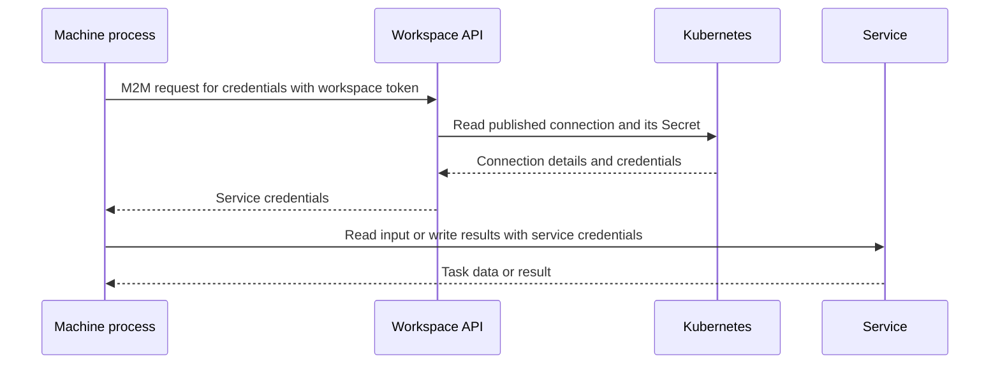

# Automation and workspace tokens

A user with the workspace's `ws_admin` role or global admin access can request
a token from `GET /workspaces/<workspace>/token`.

| Request | Grant | Token identity | Workspace roles |
| --- | --- | --- | --- |
| No `scope` query | Client credentials | Workspace service account | `ws_api` |
| Profile scopes in `scope` | User-token exchange | Original caller | `ws_api` and the requested profile roles |

Both flows use the existing workspace OAuth client. Client credentials stay
on the API server. Identity provider URLs must use HTTPS. Token responses
are not cached and do not include refresh tokens.

## Simple token brokering

Omit `scope` to obtain a service-account token for an M2M process:

```bash
curl -H 'Authorization: Bearer <user-access-token>' \
  https://api.example.org/workspaces/ws-alice/token
```

The caller's token authorizes issuance. It is not sent as the subject of the
client-credentials grant, and its roles are not copied to the result.

The relevant request from Workspace API to the identity provider is:

```text
POST /realms/workspaces/protocol/openid-connect/token
Authorization: Basic <encoded-workspace-client-credentials>
Content-Type: application/x-www-form-urlencoded

grant_type=client_credentials&audience=workspace-api
```

For this grant, Keycloak's configured audience mappers determine the token's
`aud`; the `audience` parameter does not restrict it. Configure both required
audiences as described under Provider and login requirements.

An API response can look like this. All token and credential values in these
examples are placeholders:

```json
{
  "access_token": "<workspace-service-account-access-token>",
  "token_type": "Bearer",
  "expires_in": 300,
  "scope": "profile email"
}
```

The relevant decoded access-token claims are:

```json
{
  "iss": "https://identity.example.org/realms/workspaces",
  "sub": "<workspace-service-account-id>",
  "aud": ["workspace-api", "ws-alice"],
  "resource_access": {
    "ws-alice": {"roles": ["ws_api"]}
  }
}
```

Pass the returned access token to the machine process. It can use Workspace
API to obtain service credentials. This token has no vcluster role. The API
rejects a brokered token that contains additional authorization roles. The
issuer sets the token lifetime; `300` is an example. JWT excerpts omit time
claims and signatures.

## Scoped user-token exchange

Supply a space-separated `scope` query to request selected vcluster profiles.
For example, this Datalab configuration defines an exchange profile:

```yaml
vclusters:
  vc0:
    groups:
    - name: namespace-demo
      namespace: demo
      role: edit
    secretBindings: []
```

Its OAuth scope is `ws-alice:vclusters_vc0_namespace-demo`. Its token role is
`vcluster_vc0_namespace-demo`. The API accepts full scope names only:

```bash
curl --get \
  -H 'Authorization: Bearer <user-access-token>' \
  --data-urlencode 'scope=ws-alice:vclusters_vc0_namespace-demo' \
  https://api.example.org/workspaces/ws-alice/token
```

Put several scope names in the same query value, separated by spaces. The API
removes duplicate names. An empty `scope` is invalid; it does not select the
client-credentials flow. Only configured, ready access profiles are accepted.
Interactive scopes and the reserved `cluster-admin` profile are rejected.

The caller must still have token-issuance permission. Global admin status
does not bypass the exchange role checks. For this example, relevant claims
in the caller's access token are:

```json
{
  "iss": "https://identity.example.org/realms/workspaces",
  "sub": "<alice-user-id>",
  "aud": ["workspace-api", "ws-alice"],
  "resource_access": {
    "ws-alice": {
      "roles": ["ws_admin", "ws_api", "vcluster_vc0_namespace-demo"]
    }
  }
}
```

The caller must hold `ws_api` and every requested profile role. Its token must
use the published workspace issuer and include the workspace in `aud`, unless
it was issued to that workspace client (`azp`). The gateway verifies the
incoming token's signature, issuer, and expiry before it reaches this API.

Workspace API uses that original access token as `subject_token`. It
authenticates with the existing workspace client credentials. The relevant
form fields sent to the identity provider are shown separately for readability:

```text
grant_type=urn:ietf:params:oauth:grant-type:token-exchange
subject_token=<original-user-access-token>
subject_token_type=urn:ietf:params:oauth:token-type:access_token
requested_token_type=urn:ietf:params:oauth:token-type:access_token
scope=ws-alice:vclusters_vc0_namespace-demo
audience=workspace-api
audience=ws-alice
```

An API response can look like this:

```json
{
  "access_token": "<restricted-user-access-token>",
  "token_type": "Bearer",
  "expires_in": 300,
  "scope": "profile email ws-alice:vclusters_vc0_namespace-demo"
}
```

The relevant decoded access-token claims are:

```json
{
  "iss": "https://identity.example.org/realms/workspaces",
  "sub": "<alice-user-id>",
  "aud": ["workspace-api", "ws-alice"],
  "scope": "profile email ws-alice:vclusters_vc0_namespace-demo",
  "resource_access": {
    "ws-alice": {
      "roles": ["ws_api", "vcluster_vc0_namespace-demo"]
    }
  }
}
```

The user subject stays the same. The result contains no `ws_admin`,
`ws_access`, built-in cluster-admin, or unrequested profile roles. The API
verifies the issuer's signature, token validity, issuer, user subject, exact
audiences, granted scopes, and authorization roles before it returns the token.
It rejects missing requested roles even if the identity provider reports
success. It also rejects realm roles and resource authorization permissions.

Pass this token to the machine process. It can request service credentials
from Workspace API and use the selected vcluster profile. For the example,
`ws_api` permits service credential requests, while the profile permits
Kubernetes `edit` operations in `demo`:

```http
GET https://ws-alice.lab.example.org/.vc0/api/v1/namespaces/demo/pods
Authorization: Bearer <restricted-user-access-token>
```

The vcluster maps the profile role to
`datalab:ws-alice:vcluster_vc0_namespace-demo` and applies its Kubernetes RBAC.
A downloaded kubeconfig profile selects the endpoint and default namespace;
it does not change the token's permissions.

## Provider and login requirements

Provider Datalab must enable standard token exchange on the existing workspace
client, keep only `ws_api` as its baseline role mapping, and create the optional
profile scopes. It must block its interactive scope during exchange and map
both required audiences. Add the API audience, normally `workspace-api`, to
`data.iam.extraAudiences` in the provider's EnvironmentConfig. The workspace
audience is included automatically. The API does not create scopes or change
role grants.

Workspace users receive `ws_access`, `ws_api`, and additional configured profile
roles. Workspace admins also receive `ws_admin` and each instance's built-in
cluster-admin role. The service account retains only `ws_api`.

Login through `workspace-api` uses that client's own scope mappings. Verify
that its user token includes the workspace audience and the requested roles.
Direct login through a workspace client must request its optional scopes;
`<workspace>:interactive` supplies the interactive workspace/admin roles, and
profile scopes select additional vcluster roles. Device flow uses the same
scope selection if that capability is enabled on the login client.

Exchange tokens can contain the requested profile scopes plus the identity
scopes `openid`, `basic`, `profile`, and `email`. Other scopes are rejected.
The API audience is `AUTH_AUDIENCE`, which defaults to `workspace-api`. Both
flows require it; exchange requires exactly that audience and the workspace.

Invalid or unconfigured profile scopes return 422. Missing issuance permission
or caller grants return 403. A profile that is not ready returns 503. Issuer,
token endpoint, signing-key, or returned claim failures return 502. There is no
fallback from exchange to client credentials. Already-issued tokens can remain
valid until expiry; removing a profile does not rewrite their claims.

See [Keycloak token exchange](https://www.keycloak.org/securing-apps/token-exchange)
for the underlying grant.

## M2M access to services

The machine process sends the supplied workspace token with its requests to
Workspace API. The API returns the selected service credentials. The process
uses those credentials to do the task:



For example, a user can pass a token to a batch job on another machine. The
job requests S3 credentials, reads input files from a workspace bucket, and
writes its results back. The token is used with Workspace API; the S3
credentials are used with the bucket.

```bash
curl -H 'Authorization: Bearer <workspace-token>' \
  https://api.example.org/workspaces/ws-alice
```

Existing S3 clients can continue to read the primary bucket credentials from
`storage.credentials`, with `bucketname`, `access`, `secret`, `endpoint`, and
`region`.

The workspace response lists available connections. Use these query parameters
to select which credentials to return. Credentials are returned only for ready
connections; unavailable credentials have a `resolution_error`.

| Query | Credentials to return |
| --- | --- |
| No `resolve_connections` | Primary S3 connection (`s3:primary`) |
| `resolve_connections=postgres:pg0` | Named PostgreSQL connection |
| `resolve_connections=*` | All service connections |
| `resolve_connections=none` | No service credentials |
| No `resolve_oauth2` | No OAuth2 client credentials |
| `resolve_oauth2=client:ws-alice` | Named OAuth2 client |
| `resolve_oauth2=*` | All OAuth2 clients |

Repeat a parameter to select several connections. Use `type:*` to select all
connections of one type. OAuth2 credentials are omitted unless requested.
The `ws_api` role can read service credentials but cannot read OAuth2 client
credentials. Virtual cluster connection Secrets must contain configuration
without client secrets or access tokens.

The dashboard requests all service credentials and, when permitted, OAuth2
credentials. Credential and token responses disable caching.
See `/docs` for the API endpoints and response fields.
